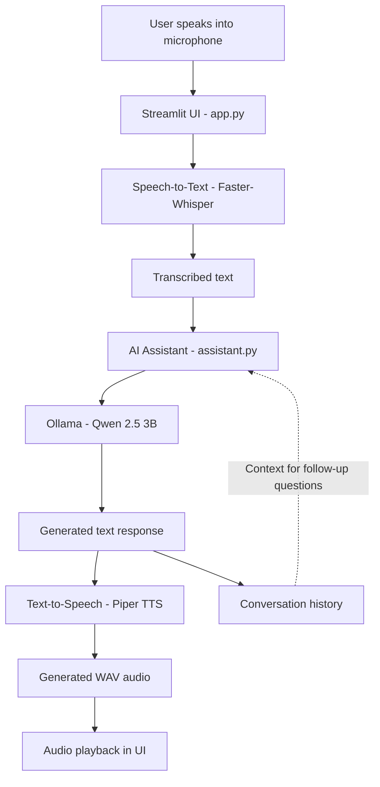

# AI Voice Assistant

A locally running AI Voice Assistant that converts spoken questions into text, generates intelligent responses using a Large Language Model (LLM), and converts the responses back into speech.

## Overview

This project integrates Speech-to-Text (STT), a locally hosted LLM, and Text-to-Speech (TTS) to provide a conversational voice assistant through a Streamlit web interface.

The application allows users to record voice questions, view transcriptions, receive AI-generated responses, listen to spoken answers, and maintain conversation context during a session.

## Features

- **Voice Input:** Record questions using the microphone in the web interface.
- **Speech-to-Text:** Convert recorded speech into text using Faster-Whisper.
- **AI-Powered Responses:** Generate responses using the Qwen 2.5 3B model through Ollama.
- **Text-to-Speech:** Convert generated answers into speech using Piper TTS.
- **Audio Playback:** Listen to generated responses.
- **Conversation History:** Maintain context across follow-up questions during a session.
- **Interactive UI:** Use the Streamlit interface to interact with the assistant.
- **Local Processing:** Run the language model and speech processing locally without requiring a cloud-based LLM API.

## Technology Stack

| Component | Technology |
|---|---|
| Programming Language | Python 3.11 |
| User Interface | Streamlit |
| Speech-to-Text | Faster-Whisper |
| Language Model | Qwen 2.5 3B |
| LLM Runtime | Ollama |
| Text-to-Speech | Piper TTS |
| Audio Recording | SoundDevice |
| Audio Processing | SoundFile, SciPy |
| HTTP Requests | Requests |

## Project Structure

```text
AI Voice Assistant/
├── app.py
├── assistant.py
├── stt.py
├── tts.py
├── record_audio.py
├── requirements.txt
├── README.md
├── .gitignore
├── models/
│   └── piper/
│       ├── en_US-lessac-medium.onnx
│       └── en_US-lessac-medium.onnx.json
└── recordings/
```

**Note:** The `models/` and `recordings/` directories are local runtime directories and should generally be excluded from GitHub. The Piper voice model must be downloaded separately.

## Prerequisites

Before running the application, install or configure:

- Python 3.11
- [Ollama](https://ollama.com/)
- A working microphone and audio output device
- Git (for version control)

## Installation and Setup

### 1. Clone the repository

```bash
git clone <YOUR_GITHUB_REPOSITORY_URL>
cd <YOUR_REPOSITORY_FOLDER>
```

Replace the placeholders with your actual GitHub repository URL and folder name.

### 2. Create a virtual environment

On Windows PowerShell:

```powershell
python -m venv .venv
.\.venv\Scripts\Activate.ps1
```

### 3. Install dependencies

```powershell
python -m pip install --upgrade pip
pip install -r requirements.txt
```

### 4. Download the language model

Ensure Ollama is installed, then run:

```powershell
ollama pull qwen2.5:3b
```

### 5. Configure Piper TTS

Download the Piper voice model `en_US-lessac-medium` and its corresponding JSON configuration file.

Place both files in:

```text
models/piper/
```

Ensure the model paths used in `tts.py` match this directory structure.

### 6. Start Ollama

Ensure the Ollama service is running. If it is not already running, open a terminal and execute:

```powershell
ollama serve
```

If Ollama is already running as a background service, you do not need to start it again.

### 7. Run the application

Open another terminal in the project directory and execute:

```powershell
$env:OPENBLAS_NUM_THREADS = "1"
$env:OMP_NUM_THREADS = "1"
streamlit run app.py
```

Open the local URL displayed in the terminal, usually:

`http://localhost:8501`

## How to Use

1. Launch the Streamlit application.
2. Record a question using the microphone.
3. Click the processing button to submit the recording.
4. Review the transcribed text.
5. Read the AI-generated response.
6. Play the generated audio response.
7. Ask follow-up questions to test conversational context.
8. Clear the visible conversation when needed.


## System Architecture



### Component Responsibilities

- **Streamlit (`app.py`):** Provides the user interface and coordinates the voice interaction.
- **Faster-Whisper (`stt.py`):** Converts recorded speech into text.
- **Ollama + Qwen 2.5 3B (`assistant.py`):** Generates answers using the conversation context.
- **Piper TTS (`tts.py`):** Converts generated answers into speech.
- **Audio playback:** Allows users to listen to the generated response.

## Hardware and Performance

The application was developed and tested in a local Windows environment.

- **Operating System:** Windows
- **Python Version:** 3.11.5
- **System RAM:** Approximately 15.4 GB
- **Graphics:** AMD Radeon integrated graphics
- **Speech Recognition Model:** Faster-Whisper `base`
- **LLM:** Qwen 2.5 3B
- **Speech Synthesis Voice:** Piper `en_US-lessac-medium`

Actual response times depend on the hardware, model loading, input duration, and system load. Measure and record your observed latency before reporting performance benchmarks.

## Troubleshooting

### Ollama connection error

Verify that Ollama is installed, the model is available, and the service is running:

```powershell
ollama list
ollama run qwen2.5:3b
```

### Microphone not working

- Check microphone permissions in Windows.
- Verify that the correct input device is selected.
- Allow browser microphone access for the Streamlit page.

### Audio playback problems

- Check the selected output device and volume.
- Verify that the Piper model and configuration paths are correct.
- Ensure the generated WAV file exists and is valid.

### OpenBLAS or threading issues

Before starting Streamlit, set:

```powershell
$env:OPENBLAS_NUM_THREADS = "1"
$env:OMP_NUM_THREADS = "1"
```

## Future Enhancements

- Add support for multiple languages and voice models.
- Improve streaming responses and reduce perceived latency.
- Add configurable voices and speech settings.
- Improve error handling and application logging.
- Add optional persistent conversation storage.
- Package the application for easier deployment.

## Conclusion

This project demonstrates the integration of speech recognition, locally hosted language models, speech synthesis, and a web-based interface to create a conversational AI Voice Assistant.

## Author

Developed as part of an internship assignment for **Trikon Software Labs LLP**.

